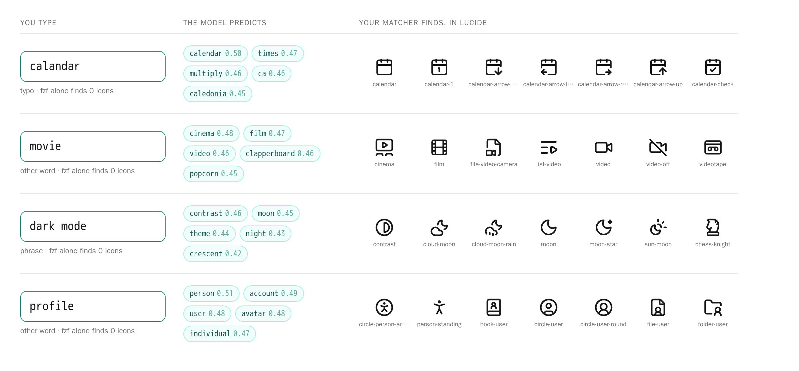

# gpu-icons-search

[![npm version][npm-version-src]][npm-version-href]
[![npm downloads][npm-downloads-src]][npm-downloads-href]
[![bundle][bundle-src]][bundle-href]
[![JSDocs][jsdocs-src]][jsdocs-href]
[![License][license-src]][license-href]

Search icons by meaning, not just by spelling. A tiny model runs right in the browser, on the GPU or on the CPU, and suggests the words that icon sets use for what the user typed.



| You type | The model suggests |
| --- | --- |
| `movie` | `cinema`, `film`, `video` |
| `calandar` | `calendar` |
| `hom` | `house`, `property`, `roof` |

It copes with plain words, short phrases, half-typed words and typos.

## Why

Icon sets name the same thing in different ways. Someone who types `movie` may never find the icon called `film`. Until now, the fix was a hand-written alias list that someone had to keep up to date.

This model replaces that list. It only suggests words. Your own text matcher (for example [fzf](https://github.com/ajitid/fzf-for-js)) still finds the icons, so it fits into any search you already have. [Icones](https://github.com/antfu-collective/icones) is the first intended user.

## How good is it?

We measure how often the first screen of results holds a correct icon.

| Search | Correct icon on the first screen |
| --- | --- |
| Icones today | 27.5% |
| With this model | 53.6% |

> [!NOTE]
> This project is experimental. [MODEL_CARD.md](./MODEL_CARD.md) has the full scores and the limits of the current model.

## Install

```sh
npm install gpu-icons-search
```

## Quick start

```ts
import { predict } from 'gpu-icons-search'

const predictions = await predict('hom')
// [
//   { word: 'house', score: 0.45, from: 'hom', kind: 'related' },
//   { word: 'property', score: 0.39, from: 'hom', kind: 'related' },
//   { word: 'roof', score: 0.39, from: 'hom', kind: 'related' },
//   ...
// ]
```

- You get a short list of words, best first.
- Words that already contain what the user typed (like `home`) are left out, because your matcher finds them anyway.
- The model loads on the first call. It runs on WebGPU if the browser has it, and on the CPU if not.

### More control

Create your own predictor to choose the weight file and decide when to free the GPU.

```ts
import { createPredictor } from 'gpu-icons-search'

const predictor = await createPredictor({ weights: '/assets/model.bin' })
console.log(predictor.backend) // 'webgpu' or 'cpu'
const controller = new AbortController()
console.log(await predictor.predict('shoping cart', { limit: 8, signal: controller.signal }))
predictor.dispose()
```

Abort a call when the user presses the next key. The old result is then dropped.

## Use it with fzf

The idea: search for what the user typed first, then add the matches for each suggested word. The user's own words stay on top.

```ts
import { extendedMatch, Fzf } from 'fzf'
import { predict } from 'gpu-icons-search'

const fzf = new Fzf(iconNames, { casing: 'case-insensitive', match: extendedMatch })

async function search(query: string): Promise<string[]> {
  const results = new Set(fzf.find(query).map(entry => entry.item))
  for (const prediction of await predict(query)) {
    // The quote makes fzf match the word exactly
    for (const entry of fzf.find(`'${prediction.word}`))
      results.add(entry.item)
  }
  return [...results]
}
```

`training/src/search.ts` has a fuller example that also handles longer queries.

## WebGPU or CPU

The model has two backends. They read the same weight file and give the same predictions.

| `backend` | Where the model runs |
| --- | --- |
| `'auto'` (the default) | On WebGPU if the browser has a usable GPU, and on the CPU if not |
| `'webgpu'` | On WebGPU only. `createPredictor` rejects if there is no usable GPU. |
| `'cpu'` | On the CPU, in plain JavaScript. It needs no GPU, and it works in workers. |

```ts
import { createPredictor } from 'gpu-icons-search'

const predictor = await createPredictor({ backend: 'cpu' })
```

One query is a small job, so the CPU is fast enough. A call takes about 1 ms for a short query, and about 8 ms for the longest query that the model reads. A CPU call blocks its thread for that time. [MODEL_CARD.md](./MODEL_CARD.md) has the measurements.

`isSupported()` tells if the environment has WebGPU. The CPU backend also runs in Node. There, pass the weight file as an `ArrayBuffer`, because Node cannot fetch a file URL.

### A smaller download

The weight file is about 840 KB compressed. If that is too much, the package also includes a ready-made table of suggestions for common words, at about 67 KB. It is less smart: whole words only, with no typos and no half-typed words.

```ts
import { loadAliasTable, predictFromTable } from 'gpu-icons-search/fallback'

const table = await loadAliasTable()
console.log(predictFromTable(table, 'movie'))
```

## How it works

In short, the model turns words into points in a space where similar meanings sit close together. It then looks up the nearest known icon words.

| Step | Where | What happens |
| --- | --- | --- |
| Split | CPU | Cut the query into words and look each one up with a hash |
| Understand | GPU or CPU | Turn each word, and the whole query, into a vector |
| Compare | GPU or CPU | Score the vector against every word in the word list |
| Pick | GPU or CPU | Keep the best words |

The model is small on purpose. Its weights are compressed hard, so the whole download, word list included, is under 1 MB and has no runtime dependencies.

## Development

The repository has three parts:

| Folder | Purpose |
| --- | --- |
| `/` (root) | The published package: the WebGPU runtime and the CPU runtime in `src/` |
| `training/` | Data pipeline, benchmark and PyTorch training |
| `playground/` | Side-by-side comparison with the Icones search |

You need Node.js 22 or later, pnpm, and [uv](https://docs.astral.sh/uv/) for the Python part. On Linux without a GPU, also install Playwright Chromium: it gives WebGPU a software driver.

```sh
pnpm install
pnpm data       # read Iconify and the tag sources, build the training targets
pnpm bench      # print the benchmark table of the baselines
pnpm train      # fit a candidate with PyTorch (uses the Apple GPU on a Mac)
pnpm evaluate   # run the candidate on real WebGPU and score it
pnpm promote    # copy the candidate into weights/ if it passes the ship gate
pnpm play       # start the playground
```

`pnpm -C training run demo` builds the page behind the image at the top of this file.

More reading: [PLAN.md](./PLAN.md) for design decisions, [THIRD_PARTY_NOTICES.md](./THIRD_PARTY_NOTICES.md) for training data and licenses.

## Prior art

Three projects showed that a small trained model with a hand-written WebGPU runtime can replace hand-written rules. This project follows their approach:

- [gpu-lexer](https://github.com/vercel-labs/gpu-lexer) by Shu Ding: a syntax highlighter for every language.
- [gpu-time](https://github.com/arikchakma/gpu-time) by Arik Chakma: a parser for date and time expressions.
- [gpu-cron](https://github.com/manuschillerdev/gpu-cron) by Manu Schiller: a parser for recurring schedules.

These ideas come from them:

- A tiny model with shaders written for that one model and no runtime dependencies.
- Hashed word features, so the input needs no word list.
- Heavily compressed weights, with training that adapts to the compression.
- A new model must match the training framework on real WebGPU and pass a benchmark before it ships.

The task differs. Those models give each word of the input a label. This model finds the closest words in a word list.

The project also builds on:

- [Icones](https://github.com/antfu-collective/icones): its manual alias list is the problem that this model solves, and a test set of the benchmark.
- [Iconify](https://iconify.design/): the icon names and the word list come from its icon sets.
- [fzf for JavaScript](https://github.com/ajitid/fzf-for-js): the text matcher of Icones and of the reference integration.

The code, the training data pipeline and the weights of this project are original.

## Sponsors

<p align="center">
  <a href="https://cdn.jsdelivr.net/gh/antfu/static/sponsors.svg">
    
  </a>
</p>

## License

[MIT](./LICENSE) License © [Anthony Fu](https://github.com/antfu)

<!-- Badges -->

[npm-version-src]: https://img.shields.io/npm/v/gpu-icons-search?style=flat&colorA=080f12&colorB=1fa669
[npm-version-href]: https://npmx.dev/package/gpu-icons-search
[npm-downloads-src]: https://img.shields.io/npm/dm/gpu-icons-search?style=flat&colorA=080f12&colorB=1fa669
[npm-downloads-href]: https://npmx.dev/package/gpu-icons-search
[bundle-src]: https://img.shields.io/bundlephobia/minzip/gpu-icons-search?style=flat&colorA=080f12&colorB=1fa669&label=minzip
[bundle-href]: https://bundlephobia.com/result?p=gpu-icons-search
[license-src]: https://img.shields.io/github/license/antfu/gpu-icons-search.svg?style=flat&colorA=080f12&colorB=1fa669
[license-href]: https://github.com/antfu/gpu-icons-search/blob/main/LICENSE
[jsdocs-src]: https://img.shields.io/badge/jsdocs-reference-080f12?style=flat&colorA=080f12&colorB=1fa669
[jsdocs-href]: https://www.jsdocs.io/package/gpu-icons-search
